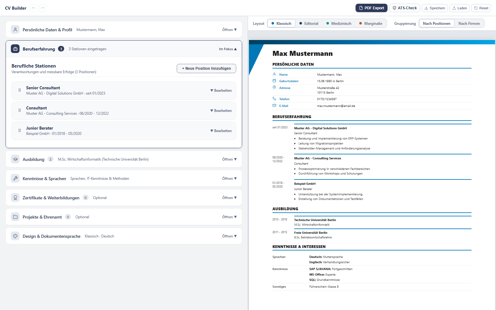

# CV Builder

Lebenslauf-Editor für deutsche Bewerbungen, der vollständig im Browser läuft.
Lokal ausführbar: keine Installation, kein Konto, kein Server.



Entstanden als privates Projekt, um Bewerbungen ohne Abo-Dienst schreiben zu
können. Entwickelt mit KI-Unterstützung.

## Funktionen

- Editor links, Live-Vorschau rechts als echte A4-Seiten mit Seitenumbrüchen
- Vier Layouts: Klassisch, Editorial, Medizinisch, Marginalie
- Bewerbungsfoto und eingescannte Unterschrift mit Ort und Datum
- Berufserfahrung nach Positionen oder nach Firmen gruppiert, Reihenfolge per
  Drag & Drop
- Beschäftigungsdauer automatisch aus den Zeiträumen berechnet, wahlweise bei
  Firma und Position, nur bei einem von beiden oder gar nicht (siehe unten)
- Ausbildung, Kenntnisse und Sprachen, Zertifikate, Projekte, Ehrenamt
- Akzentfarbe, Schriftart und Schriftgröße anpassbar; Ausgabe auf Deutsch oder
  Englisch
- Rückgängig und Wiederholen (Strg+Z, Strg+Y)
- Automatische Zwischenspeicherung im Browser, Sicherung und Austausch als
  JSON-Datei
- PDF-Export über den Druckdialog des Browsers
- Hinweis, sobald der Lebenslauf länger als zwei Seiten wird
- ATS-Check: einfache Prüfregeln zur Maschinenlesbarkeit und zum Inhalt (siehe
  unten)

## Schnellstart

1. Repository herunterladen (`Code` → `Download ZIP`) und entpacken, oder
   klonen.
2. `cv-builder.html` in Chrome oder Edge öffnen.
3. Daten eintragen. Der Stand wird automatisch im Browser zwischengespeichert.
   Mit `Speichern` legst du zusätzlich eine JSON-Datei als Sicherung ab, mit
   `Laden` holst du sie zurück.
4. `PDF Export` öffnet den Druckdialog. Dort „Als PDF speichern“ wählen.

Die Ordner `layouts/`, `styles/` und `fonts/` müssen neben der HTML-Datei
liegen. Fehlen sie, bleibt die Vorschau leer oder die Oberfläche ungestaltet.

## Datenschutz

- Alle Daten bleiben im Browser. Es gibt keinen Server und keine
  Netzwerkanfragen; auch die Schriften liegen im Repository.
- Die automatische Zwischenspeicherung nutzt den lokalen Speicher des Browsers
  (`localStorage`). Wer die Browserdaten löscht, löscht auch den Entwurf.
  Deshalb regelmäßig mit `Speichern` sichern.
- Foto und Unterschrift sind Teil der JSON-Datei. Behandle die Datei wie den
  Lebenslauf selbst.
- Auf fremden oder gemeinsam genutzten Rechnern bleibt der Entwurf im Browser
  zurück. Nach der Arbeit deshalb `Reset` klicken (überschreibt den Entwurf mit
  den Beispieldaten) oder die Browserdaten löschen.

## Layouts

| Layout | Charakter |
|---|---|
| Klassisch | Konservativ mit Farbband und Tabelle für persönliche Daten |
| Editorial | Ruhig und typografisch, Schrift Plus Jakarta Sans |
| Medizinisch | Klar, mit farbigem Kopfbereich; für Praxen, Kliniken und Gesundheitswesen |
| Marginalie | Abschnittstitel in einer Randspalte, Serifenschrift, ein Farbakzent |

## Beschäftigungsdauer

Zu jedem Zeitraum der Berufserfahrung kann die Dauer stehen, zum Beispiel
„2 Jahre, 4 Monate“: unter dem Zeitraum, wo daneben Platz frei ist, sonst in
derselben Zeile. So rutscht durch die Dauer nichts nach unten. Der Zeitraum
selbst bleibt unverändert sichtbar. Einstellbar unter „Design &
Dokumentensprache“:

- bei Firmengruppe und Position (Standard)
- nur bei der Firmengruppe
- nur bei der Position
- nicht anzeigen

Bei der Gruppierung nach Positionen gibt es keinen Firmenkopf; dann steht die
Dauer an den Positionen.

So wird gerechnet:

- Erkannt werden Monatsangaben wie `01/2020 - 01/2025`, `01.2020 – 06.2020`,
  `März 2021 – Mai 2023`, `seit 06/2026`, `since 06/2026`, `06/2020 - heute`
  oder `06/2020 - present`.
- Start- und Endmonat zählen mit: `01/2020 - 12/2020` ergibt 1 Jahr.
- Laufende Stellen zählen bis zum aktuellen Monat. Die angezeigte Dauer ändert
  sich also mit der Zeit.
- Für die Gesamtdauer bei einer Firma zählen überlappende Zeiträume einmal;
  Lücken zwischen Positionen zählen nicht mit.
- Bei unklaren Angaben, etwa reinen Jahreszahlen (`2016 - 2019`) oder einem
  einzelnen Monat, erscheint keine Dauer. Lässt sich eine Position einer Firma
  nicht berechnen, entfällt auch die Gesamtdauer dieser Firma.

## ATS-Check

Viele Unternehmen lesen Bewerbungen zuerst mit einem Bewerbermanagementsystem
(englisch Applicant Tracking System, ATS) aus. Der ATS-Check prüft den Text der
Vorschau mit einfachen Regeln:

- Technisch: Name im Kopfbereich, vollständige Kontaktdaten, gängige
  Abschnittsüberschriften, saubere Trennzeichen, einheitliche Datumsangaben,
  keine Symbolreste im Text.
- Inhaltlich: Kurzprofil vorhanden, Stichpunkte nicht zu lang, Ergebnisse mit
  Zahlen belegt.

Der Check ist kein echter ATS-Parser und ersetzt keinen Test mit einem echten
System.

## Eigenes Layout

Ein Layout ist eine JavaScript-Datei in `layouts/`, die sich in
`window.CV_LAYOUTS` registriert. Sie liefert CSS und eine Funktion, die aus den
Daten HTML erzeugt. Seitenumbruch, Vorschau und PDF-Export übernimmt der Editor.

```js
(function () {
  window.CV_LAYOUTS = window.CV_LAYOUTS || {};

  window.CV_LAYOUTS['mein-layout'] = {
    name: 'Mein Layout',
    desc: 'Kurzbeschreibung für den Tooltip',
    accent: '#2e3a59',

    css: `
      .cv-root { font-family: 'Segoe UI', Arial, sans-serif; font-size: 9.5px; line-height: 1.45; }
      .cv-body { padding: 18mm 20mm 12mm; }
      .cv-sh { margin: 14px 0 6px; font-size: 11px; font-weight: 700; text-transform: uppercase; }
    `,

    render: function (data, grouping, h) {
      var out = '<div class="cv-body">';
      out += '<h1>' + h.esc(data.personal.name) + '</h1>';
      out += '<h2 class="cv-sh">' + h.t('experience_upper') + '</h2><div class="cv-sh-line"></div>';
      out += h.renderExperience(data, grouping, h.lang);
      out += h.renderOptionalSections(data, h.lang);
      out += h.renderSignature(data, h.lang);
      return out + '</div>';
    }
  };
})();
```

Danach in `cv-builder.html` eine Zeile ergänzen:

```html
<script src="layouts/mein-layout.js"></script>
```

Die vorhandenen Layouts zeigen, wie Ausbildung, Kenntnisse und Kopfbereich
aufgebaut sind. Einige Regeln, damit Seitenumbruch und PDF funktionieren:

- Abschnitte als `h2.cv-sh` mit direkt folgendem `div.cv-sh-line`, Einträge als
  `.cv-entry`, `.cv-edu`, `.cv-cg` und `.cv-sub`. Darauf stützen sich die
  Seitenumbruch-Regeln. Die Hilfsfunktionen `renderExperience` und
  `renderOptionalSections` erzeugen diese Struktur bereits.
- Elemente mit Text nicht mit `position: relative` oder `absolute`
  platzieren. Chrome schreibt solche Elemente erst am Seitenende ins PDF.
  Ein ATS liest dann zum Beispiel Firma und Rolle getrennt voneinander.
- Bei eigenen Schriften prüfen, ob im PDF-Text die Leerzeichen erhalten
  bleiben, zum Beispiel mit `pdftotext`. Bei manchen Schriften gehen sie
  verloren; ein leicht erhöhter Wortabstand (`word-spacing: 0.1em`) behebt das.
- Schriften als `@font-face` in `styles/fonts.css` eintragen und die Dateien
  nach `fonts/` legen.
- Für eine eigene Darstellung der Beschäftigungsdauer stehen `h.periodMonths`,
  `h.totalMonths`, `h.formatDuration`, `h.durationHtml` und `h.showDurationAt`
  bereit. `renderExperience` nutzt sie bereits.

## Grenzen

- Entwickelt und getestet mit Chrome. Andere Browser sind nicht getestet.
- Der Seitenumbruch verschiebt ganze Einträge auf die nächste Seite. Ein
  Eintrag, der länger als eine Seite ist, wird getrennt.
- In schmalen Fenstern passt die A4-Vorschau nicht ganz in die Breite und
  lässt sich seitlich scrollen.

## Lizenz

- Code: MIT-Lizenz, siehe [LICENSE](LICENSE).
- Schriften und Icons stammen von Dritten und stehen unter eigenen freien
  Lizenzen (SIL Open Font License, MIT, ISC, Apache 2.0). Übersicht in
  [THIRD-PARTY-NOTICES.md](THIRD-PARTY-NOTICES.md).

Die Software wird ohne Gewähr bereitgestellt. Ob ein Lebenslauf bei einem
Unternehmen ankommt, hängt von dessen System und Menschen ab, nicht von
diesem Werkzeug.
