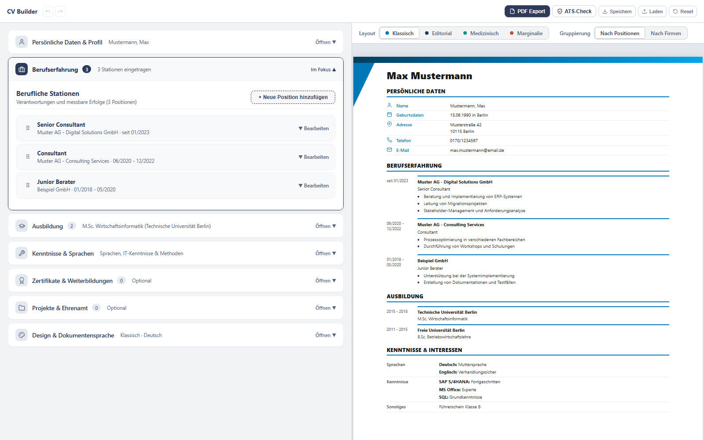

# CV Builder

Lebenslauf-Editor für deutsche Bewerbungen, der vollständig im Browser läuft.
Lokal ausführbar: keine Installation, kein Konto, kein Server.



Entstanden als privates Projekt, um Bewerbungen ohne Abo-Dienst schreiben zu
können. Entwickelt mit KI-Unterstützung.

## Funktionen

- Editor links, Live-Vorschau rechts als echte A4-Seiten mit Seitenumbrüchen
- Vier Layouts: Klassisch, Editorial, Medizinisch, Marginalie
- Bewerbungsfoto und eingescannte Unterschrift mit Ort und Datum
- Berufserfahrung nach Positionen oder nach Firmen gruppiert, Reihenfolge per
  Drag & Drop
- Beschäftigungsdauer automatisch aus den Zeiträumen berechnet, wahlweise bei
  Firma und Position, nur bei einem von beiden oder gar nicht (siehe unten)
- Anschreiben nach DIN 5008 mit Briefkopf im Stil des gewählten Layouts, als
  eigene PDF oder zusammen mit dem Lebenslauf in einer Datei (siehe unten)
- Ausbildung, Kenntnisse und Sprachen, Zertifikate, Projekte, Ehrenamt
- Einträge im Lebenslauf ausblenden, ohne sie zu löschen (siehe unten)
- Festes Datum für Anschreiben und Unterschrift, sonst das heutige
- Akzentfarbe, Schriftart und Schriftgröße anpassbar; Ausgabe auf Deutsch oder
  Englisch
- Rückgängig und Wiederholen (Strg+Z, Strg+Y)
- Automatische Zwischenspeicherung im Browser, Sicherung und Austausch als
  JSON-Datei
- PDF-Export über den Druckdialog des Browsers
- Hinweis, sobald der Lebenslauf länger als zwei Seiten wird
- ATS-Check: einfache Prüfregeln zur Maschinenlesbarkeit und zum Inhalt,
  Lückenprüfung im Werdegang, Abgleich mit einer Stellenanzeige und Prüfung
  des Anschreibens (siehe unten)

## Schnellstart

1. Repository herunterladen (`Code` → `Download ZIP`) und entpacken, oder
   klonen.
2. `cv-builder.html` in Chrome oder Edge öffnen.
3. Daten eintragen. Der Stand wird automatisch im Browser zwischengespeichert.
   Mit `Speichern` legst du zusätzlich eine JSON-Datei als Sicherung ab, mit
   `Laden` holst du sie zurück.
4. `PDF Export` öffnet den Druckdialog. Dort „Als PDF speichern“ wählen.
   Gedruckt wird, was gerade in der Vorschau steht: Lebenslauf, Anschreiben
   oder beides in einer Datei.

Die Ordner `layouts/`, `styles/` und `fonts/` müssen neben der HTML-Datei
liegen. Fehlen sie, bleibt die Vorschau leer oder die Oberfläche ungestaltet.

## Datenschutz

- Alle Daten bleiben im Browser. Es gibt keinen Server und keine
  Netzwerkanfragen; auch die Schriften liegen im Repository.
- Die automatische Zwischenspeicherung nutzt den lokalen Speicher des Browsers
  (`localStorage`). Wer die Browserdaten löscht, löscht auch den Entwurf.
  Deshalb regelmäßig mit `Speichern` sichern. Gibt es Änderungen und liegt die
  letzte Datei-Sicherung mindestens 7 Tage zurück (oder gab es noch keine),
  erscheint oben ein Hinweis; ein Klick darauf speichert. Als Sicherung zählen
  `Speichern` und das Laden einer Datei. Ob der Download wirklich abgelegt
  wurde, kann der Browser nicht prüfen.
- Foto, Unterschrift, Anschreiben und eine eingefügte Stellenanzeige sind Teil
  der JSON-Datei. Behandle die Datei wie den Lebenslauf selbst.
- Auf fremden oder gemeinsam genutzten Rechnern bleibt der Entwurf im Browser
  zurück. Nach der Arbeit deshalb `Reset` klicken (überschreibt den Entwurf mit
  den Beispieldaten) oder die Browserdaten löschen.

## Layouts

| Layout | Charakter |
|---|---|
| Klassisch | Konservativ mit Farbband und Tabelle für persönliche Daten |
| Editorial | Ruhig und typografisch, Schrift Plus Jakarta Sans |
| Medizinisch | Klar, mit farbigem Kopfbereich; für Praxen, Kliniken und Gesundheitswesen |
| Marginalie | Abschnittstitel in einer Randspalte, Serifenschrift, ein Farbakzent |

## Einträge ausblenden

Berufserfahrung, Ausbildung, Zertifikate, Projekte und Ehrenamt haben im Editor
je Eintrag ein Augen-Symbol. Damit fehlt der Eintrag im Lebenslauf, bleibt aber
im Editor und in der JSON-Datei erhalten, etwa für alte Nebenjobs, die für eine
bestimmte Bewerbung nicht passen. Ausgeblendete Karten sind abgeschwächt und
durchgestrichen; der Abschnittskopf nennt ihre Zahl. Auch der ATS-Check sieht
sie nicht, die Lückenprüfung eingeschlossen.

## Beschäftigungsdauer

Zu jedem Zeitraum der Berufserfahrung kann die Dauer stehen, zum Beispiel
„2 Jahre, 4 Monate“: unter dem Zeitraum, wo daneben Platz frei ist, sonst in
derselben Zeile. So rutscht durch die Dauer nichts nach unten. Der Zeitraum
selbst bleibt unverändert sichtbar. Einstellbar unter „Design &
Dokumentensprache“:

- bei Firmengruppe und Position (Standard)
- nur bei der Firmengruppe
- nur bei der Position
- nicht anzeigen

Bei der Gruppierung nach Positionen gibt es keinen Firmenkopf; dann steht die
Dauer an den Positionen.

So wird gerechnet:

- Erkannt werden Monatsangaben wie `01/2020 - 01/2025`, `01.2020 – 06.2020`,
  `März 2021 – Mai 2023`, `seit 06/2026`, `since 06/2026`, `06/2020 - heute`
  oder `06/2020 - present`.
- Start- und Endmonat zählen mit: `01/2020 - 12/2020` ergibt 1 Jahr.
- Laufende Stellen zählen bis zum aktuellen Monat. Die angezeigte Dauer ändert
  sich also mit der Zeit.
- Für die Gesamtdauer bei einer Firma zählen überlappende Zeiträume einmal;
  Lücken zwischen Positionen zählen nicht mit.
- Bei unklaren Angaben, etwa reinen Jahreszahlen (`2016 - 2019`) oder einem
  einzelnen Monat, erscheint keine Dauer. Lässt sich eine Position einer Firma
  nicht berechnen, entfällt auch die Gesamtdauer dieser Firma.

## Anschreiben

Über „Dokument“ oberhalb der Vorschau wählst du Lebenslauf, Anschreiben oder
„Beides“. Öffnest du im Editor den Abschnitt „Anschreiben“, springt die
Vorschau auf das Anschreiben, bei den Abschnitten des Lebenslaufs auf den
Lebenslauf. Bei „Beides“ bleibt die Ansicht, wie sie ist.

Der Brief übernimmt Schrift und Akzentfarbe des gewählten Layouts und hat einen
eigenen Briefkopf in dessen Stil: Name und Berufstitel links, rechts
untereinander Anschrift, Telefon, E-Mail und LinkedIn.

- Aufbau nach DIN 5008 Form B: Briefkopf 45 mm hoch, darunter das
  Anschriftfeld mit einer kleinen Rücksendezeile (Name und Anschrift) über dem
  Empfänger. Die Anschrift steht damit an der Stelle für Fensterumschläge. Ort
  und Datum stehen rechts daneben, 125 mm vom linken Rand. Danach Betreff,
  Anrede, Text, Grußformel, Unterschrift und Anlagen. Ränder links 25 mm,
  rechts 20 mm. Falz- und Lochmarken gibt es nicht.
- Absender, Unterschrift und Ort kommen aus den persönlichen Daten. Eine
  Anschrift in einer Zeile, etwa „Musterstraße 1, 12345 Musterstadt“, wird im
  Briefkopf vor der Postleitzahl umbrochen.
- Das Datum ist das heutige. Unter „Persönliche Daten“ lässt sich neben dem Ort
  ein festes Datum wählen, etwa um eine alte Bewerbung unverändert neu zu
  drucken. Es gilt für Anschreiben, Datumszeile unter dem Lebenslauf und
  PDF-Dateinamen; „Heute“ hebt es wieder auf. Liegt es mehr als 7 Tage zurück,
  weisen Editor und Anschreiben-Check darauf hin.
- Bleiben Anrede oder Grußformel leer, steht dort „Sehr geehrte Damen und
  Herren,“ und „Mit freundlichen Grüßen“, auf Englisch „Dear Sir or Madam,“
  und „Kind regards“.
- Absätze im Brieftext durch eine Leerzeile trennen. Wird der Brief länger als
  eine Seite, erscheint ein Hinweis.
- „Beides“ zeigt zuerst das Anschreiben, dann den Lebenslauf. `PDF Export`
  legt dann beide in eine Datei („…-Bewerbung_TT-MM-JJ“). Das Anschreiben hat
  keine Seitenzahl, der Lebenslauf zählt wie allein ab „Seite 1“. Zeugnisse
  fügst du bei Bedarf mit einem PDF-Werkzeug an.
- Es gibt ein Anschreiben. Für mehrere Bewerbungen den jeweiligen Stand mit
  `Speichern` als JSON-Datei sichern.

## ATS-Check

Viele Unternehmen lesen Bewerbungen zuerst mit einem Bewerbermanagementsystem
(englisch Applicant Tracking System, ATS) aus. Der ATS-Check prüft den Text der
Vorschau mit einfachen Regeln:

- Technisch: Name im Kopfbereich, vollständige Kontaktdaten, gängige
  Abschnittsüberschriften, saubere Trennzeichen, einheitliche Datumsangaben,
  keine Symbolreste im Text.
- Inhaltlich: Kurzprofil vorhanden, Stichpunkte nicht zu lang, Ergebnisse mit
  Zahlen belegt, keine Lücken von mehr als 3 Monaten im Werdegang.

Für die Lückenprüfung zählen Berufserfahrung, Ausbildung, Projekte und
Ehrenamt, soweit sie nicht ausgeblendet sind. Reine Jahreszahlen wie `2015 - 2018` gelten als ganze Jahre, damit
Schul- und Studienzeiten ohne Monat keine Scheinlücken erzeugen. Endet der
letzte Eintrag vor mehr als 3 Monaten, gibt es einen neutralen Hinweis.
Zeiträume, die sich nicht lesen lassen, werden genannt statt übergangen.

Der Check ist kein echter ATS-Parser und ersetzt keinen Test mit einem echten
System.

### Abgleich mit einer Stellenanzeige

Im Reiter „Stellenanzeige“ fügst du den Text einer Anzeige ein. Der Check zeigt,
welche Begriffe der Anzeige im Lebenslauf vorkommen und welche fehlen, und
markiert sie im Anzeigentext.

- Begriffe sind Fachbegriffe und Abkürzungen wie `SAP S/4HANA` oder
  `Power BI` sowie Substantive. Füllwörter und typische Floskeln wie
  „Homeoffice“ fallen weitgehend heraus; unpassende Begriffe lassen sich mit
  × ausblenden.
- Wortendungen und Wortteile werden angeglichen: „Projektmanagementerfahrung“
  gilt mit „Projektmanagement“ als gefunden, „Englischkenntnisse“ mit
  „Englisch“.
- Bedeutungen versteht der Abgleich nicht: „Einkauf“ und „Beschaffung“ sind
  verschiedene Wörter.
- Er läuft ohne KI und ohne Netzwerk. Der Anzeigentext wird mit dem Entwurf
  gespeichert. Englische Anzeigen werden erkannt, die Begriffssuche ist dort
  aber gröber.
- Begriffe, die im Lebenslauf fehlen, aber im Anschreiben (Betreff oder Text)
  stehen, erscheinen als „Nur im Anschreiben“ und haben in der Anzeige eine
  eigene Farbe. Die Zahl am Reiter zählt nur Treffer im Lebenslauf, denn den
  liest das ATS.
- Das Ergebnis zählt nicht zum ATS-Score. Nur ergänzen, was stimmt:
  hineinkopierte Schlagwörter fallen Menschen sofort auf.

### Anschreiben prüfen

Der Reiter „Anschreiben“ prüft den Brief aus dem Editor mit Faustregeln:

- Länge des Brieftexts zwischen 200 und 450 Wörtern. Mit der
  Standardschriftgröße passen etwa 230 Wörter auf eine Seite; darüber meldet
  die Vorschau, dass der Brief länger als eine Seite ist.
- Keine Standardfloskeln wie „hiermit bewerbe ich mich“ oder „mit großem
  Interesse habe ich Ihre Anzeige gelesen“.
- Kein Konjunktiv wie „würde“, „könnte“ oder „möchte“.
- Höchstens jeder dritte Satz beginnt mit „Ich“, der erste gar nicht.
- Kein Satz mit 25 Wörtern oder mehr.
- Höchstens zwei Eigenschaftswörter wie „teamfähig“ oder „belastbar“.
- Der Firmenname aus dem Empfänger kommt im Brieftext vor.

Steht im Reiter „Stellenanzeige“ eine Anzeige, prüft er außerdem, was die
Anzeige verlangt:

- Stellentitel im Betreff. Als Titel gilt die Zeile mit „(m/w/d)“ oder
  ähnlich, sonst die erste Zeile; der erkannte Titel wird angezeigt.
- Gehaltsvorstellung und Eintrittstermin, wenn die Anzeige danach fragt.
  Fehlen sie, setzt „Satz einfügen“ einen Mustersatz mit Platzhalter ans Ende
  des vorletzten Absatzes, etwa „Meine Gehaltsvorstellung liegt bei [Betrag] €
  brutto im Jahr.“
- Kennziffer im Betreff, wenn die Anzeige eine nennt.
- Persönliche Anrede, wenn die Anzeige eine Ansprechperson nennt. Ein Knopf
  übernimmt den Vorschlag, etwa „Sehr geehrte Frau Dr. Beispiel,“, in das
  Feld „Anrede“.
- Verlangte Unterlagen wie Lebenslauf, Zeugnisse oder Zertifikate, verglichen
  mit der Zeile „Anlagen“.

Unter „Formales“ meldet er ein festes Datum, das mehr als 7 Tage zurückliegt,
und Platzhalter in eckigen Klammern wie „[Betrag]“, die noch im Brief stehen.
Solange ein Platzhalter im Anschreiben steht, warnt auch die Vorschau; der
Hinweis erscheint nicht im PDF.

Floskeln, Konjunktiv und Eigenschaftswörter prüft der Check nur in deutschen
Briefen. Die Fundstellen sind im Brieftext markiert. Die Regeln verstehen keine
Bedeutungen, und die Zahl am Reiter zählt nicht zum ATS-Score.

## Eigenes Layout

Ein Layout ist eine JavaScript-Datei in `layouts/`, die sich in
`window.CV_LAYOUTS` registriert. Sie liefert CSS und eine Funktion, die aus den
Daten HTML erzeugt. Seitenumbruch, Vorschau und PDF-Export übernimmt der Editor.

```js
(function () {
  window.CV_LAYOUTS = window.CV_LAYOUTS || {};

  window.CV_LAYOUTS['mein-layout'] = {
    name: 'Mein Layout',
    desc: 'Kurzbeschreibung für das Layout-Menü',
    accent: '#2e3a59',

    css: `
      .cv-root { font-family: 'Segoe UI', Arial, sans-serif; font-size: 9.5px; line-height: 1.45; }
      .cv-body { padding: 18mm 20mm 12mm; }
      .cv-sh { margin: 14px 0 6px; font-size: 11px; font-weight: 700; text-transform: uppercase; }
    `,

    render: function (data, grouping, h) {
      var out = '<div class="cv-body">';
      out += '<h1>' + h.esc(data.personal.name) + '</h1>';
      out += '<h2 class="cv-sh">' + h.t('experience_upper') + '</h2><div class="cv-sh-line"></div>';
      out += h.renderExperience(data, grouping, h.lang);
      out += h.renderOptionalSections(data, h.lang);
      out += h.renderSignature(data, h.lang);
      return out + '</div>';
    }
  };
})();
```

Danach in `cv-builder.html` eine Zeile ergänzen:

```html
<script src="layouts/mein-layout.js"></script>
```

Die vorhandenen Layouts zeigen, wie Ausbildung, Kenntnisse und Kopfbereich
aufgebaut sind. Einige Regeln, damit Seitenumbruch und PDF funktionieren:

- Abschnitte als `h2.cv-sh` mit direkt folgendem `div.cv-sh-line`, Einträge als
  `.cv-entry`, `.cv-edu`, `.cv-cg` und `.cv-sub`. Darauf stützen sich die
  Seitenumbruch-Regeln. Die Hilfsfunktionen `renderExperience` und
  `renderOptionalSections` erzeugen diese Struktur bereits.
- Elemente mit Text nicht mit `position: relative` oder `absolute`
  platzieren. Chrome schreibt solche Elemente erst am Seitenende ins PDF.
  Ein ATS liest dann zum Beispiel Firma und Rolle getrennt voneinander.
- Bei eigenen Schriften prüfen, ob im PDF-Text die Leerzeichen erhalten
  bleiben, zum Beispiel mit `pdftotext`. Bei manchen Schriften gehen sie
  verloren; ein leicht erhöhter Wortabstand (`word-spacing: 0.1em`) behebt das.
- Schriften als `@font-face` in `styles/fonts.css` eintragen und die Dateien
  nach `fonts/` legen.
- Für eine eigene Darstellung der Beschäftigungsdauer stehen `h.periodMonths`,
  `h.totalMonths`, `h.formatDuration`, `h.durationHtml` und `h.showDurationAt`
  bereit. `renderExperience` nutzt sie bereits.
- Optional liefert `renderLetterHead: function (data, h)` den Briefkopf des
  Anschreibens im Stil des Layouts. Ohne ihn erscheint ein schlichter Kopf in
  der Akzentfarbe. Der Kopf muss in 45 mm Höhe passen, sonst rutscht das
  Anschriftfeld aus dem Fensterbereich. Bausteine: `.cv-lh` für die Zeile,
  darin `.cv-lh-main` für Name und Titel und `h.letterSender(data, mitSymbolen)`
  für den rechtsbündigen Absenderblock; `h.displayName` dreht „Nachname,
  Vorname“ um.

## Grenzen

- Entwickelt und getestet mit Chrome. Andere Browser sind nicht getestet.
- Der Seitenumbruch verschiebt ganze Einträge auf die nächste Seite. Ein
  Eintrag, der länger als eine Seite ist, wird getrennt.
- In schmalen Fenstern passt die A4-Vorschau nicht ganz in die Breite und
  lässt sich seitlich scrollen.

## Lizenz

- Code: MIT-Lizenz, siehe [LICENSE](LICENSE).
- Schriften und Icons stammen von Dritten und stehen unter eigenen freien
  Lizenzen (SIL Open Font License, MIT, ISC, Apache 2.0). Übersicht in
  [THIRD-PARTY-NOTICES.md](THIRD-PARTY-NOTICES.md).

Die Software wird ohne Gewähr bereitgestellt. Ob ein Lebenslauf bei einem
Unternehmen ankommt, hängt von dessen System und Menschen ab, nicht von
diesem Werkzeug.
